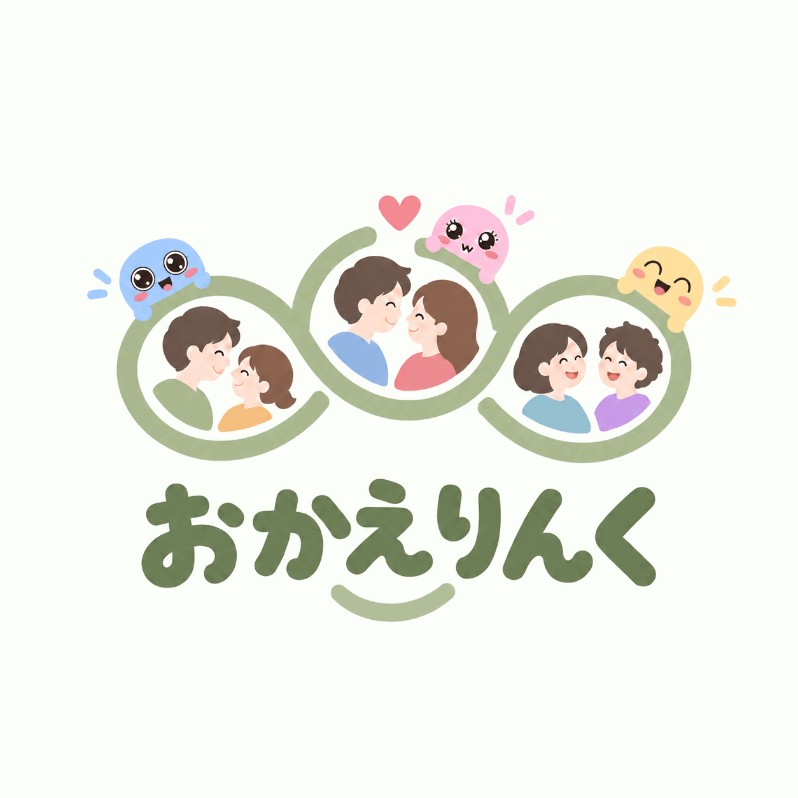
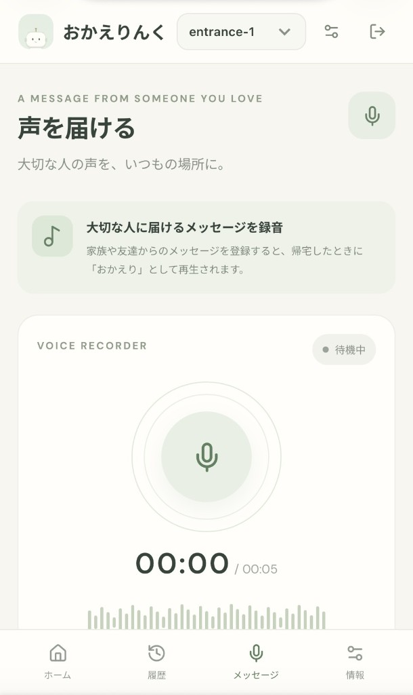
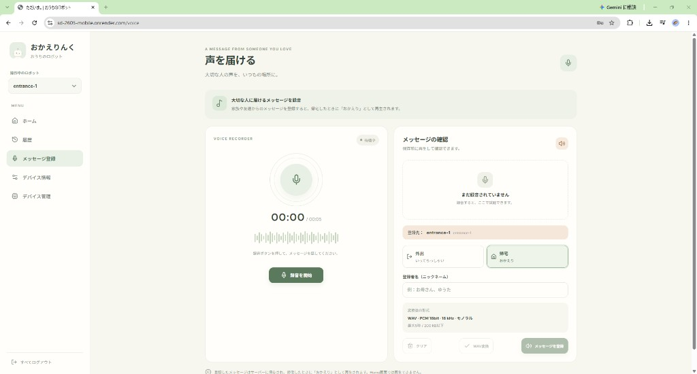
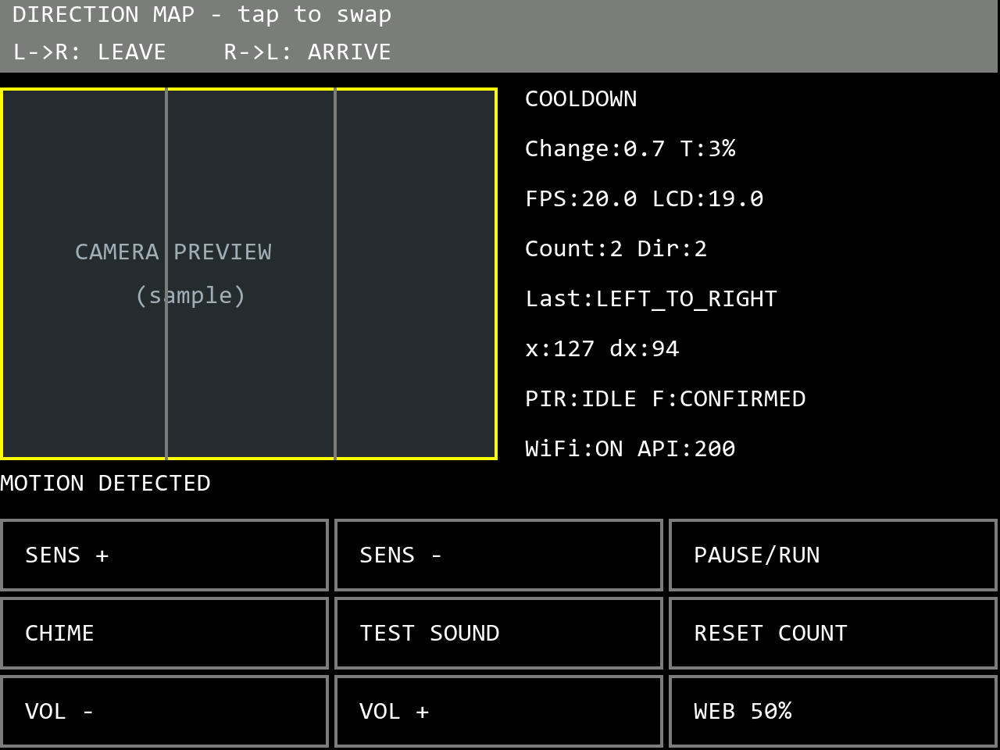

# おかえりんく

<p align="center">

  

</p>

## 各種リンク

- **アプリURL**: [https://sd-2605-mobile.onrender.com/](https://sd-2605-mobile.onrender.com/)
- スライドURL: [https://canva.link/qu8e8hxn11fekr0](https://canva.link/qu8e8hxn11fekr0)

- 本リポジトリ: [jphacks/sd_2605](https://github.com/jphacks/sd_2605)
- Webアプリの開発元: [jphacks/sd_2605-mobile](https://github.com/jphacks/sd_2605-mobile)

※公開アプリは Render の無料プランです。15分間アクセスがないとサーバーがスリープし、次に開いたときは起動まで数十秒かかります。

## 製品概要

大切な人の声で「いってらっしゃい」「おかえり」を届ける、玄関向けの音声メッセージデバイスです。このリポジトリは、その声を登録し、玄関のデバイスへ届けるWebアプリです。

### 背景（製品開発のきっかけ、課題等）

突然ですが、みなさんは一人暮らしをしたことがありますか？
実際、このプロダクトの開発メンバーは全員が一人暮らしの経験者です。そして、私たちが共通して抱えていた感情、それは――「ふとした瞬間に寂しい」ということでした。

特に、誰もいない玄関を出入りするときの静けさは、一人暮らしならではの孤独感を感じさせます。

そこで私たちは、「離れて暮らす大切な人の温もりを、日々の生活の中で感じられる体験を作りたい」と考えました。

離れて暮らす家族や恋人、友人など、大切な人が吹き込んだ「いってらっしゃい」や「おかえり」の声を、外出や帰宅のタイミングに合わせて届けます。テキストメッセージだけでは伝わりにくい、声ならではの温もりや安心感を日常に届け、離れていても大切な人とのつながりを感じることで、孤独感を和らげたい。そんな思いから、このプロダクトを開発しました。

### 製品説明（具体的な製品の説明）

Webアプリから録音・登録した大切な人の音声メッセージを、玄関に設置したデバイスで再生するプロダクトです。「いってらっしゃい」と「おかえり」のメッセージをそれぞれ登録でき、外出・帰宅を自動判定して、適切なタイミングで再生します。また、デバイスの画面には表情豊かなキャラクターを表示し、声と表情の両方で温かく送り出し、出迎えます。

ハードウェアには **M5Stack CoreS3を採用し、実機デモもCoreS3で実施しました**。内蔵カメラの画像処理によって物体の動きと左右の移動方向を検出し、PIR人感センサーの反応と組み合わせることで、人の通過を判定します。検出した移動方向から外出・帰宅を識別し、Webアプリから取得して本体に保存した音声を再生します。

さらに、**左右の移動方向と外出・帰宅の対応は、玄関の構造や設置位置に合わせて切り替え可能**です。音声はデバイス本体に保存されるため、Webアプリを閉じていても、保存済みのメッセージを再生できます。

<p align="center">
  
</p>

### 特長

#### 1. 大切な人の声を、外出・帰宅のタイミングに

ブラウザで録音・試聴し、外出用（leave）と帰宅用（arrive）の音声を登録できます。音声はPCM 16bit・モノラル・16kHzのWAVに変換し、5秒以内のメッセージとして扱います。

<p align="center">

  

  

</p>

#### 2. Webと連携し、取得した音声は本体に保存

CoreS3がWi-Fi経由でAPIに定期アクセスし、音声の版番号を比較して更新します。取得済みの音声はLittleFSに保存するため、通信できない間もローカルで再生できます。

<p align="center">

  

  

</p>

#### 3. 顔のあるデバイスと、本体での操作

顔の切り替えやまばたき、音声再生に合わせた表情を実装しています。タッチで顔を変更でき、長押しでデバッグ画面へ切り替えて音量や方向の割り当てを操作できます。

<p align="center">

  
  

</p>

### 解決出来ること

- 遠くに住む家族・友人からの声を、外出や帰宅のタイミングで受け取れます。
- Webから音声を更新でき、デバイスを操作せずにメッセージを届けられます。
- 外出用・帰宅用の音声を分け、生活の場面に合った声かけができます。

### 今後の展望

今後は検知の安定性を高め、設置環境ごとの調整や複数センサーの活用を進めます。

### 注力したこと（こだわり等）

- カメラの通過方向判定とPIR照合を組み合わせ、外出・帰宅それぞれの音声につなげること。
- 音声の保存・更新と再生を分け、通信待ちが検知や本体操作を妨げない構成にすること。
- 顔の表情やタッチ操作を通じて、玄関に置きたくなる親しみやすさを持たせること。

## 開発技術詳細

### 活用した技術

#### API・データ

- RailsのJSON API: ユーザー認証、デバイス管理、設定、音声登録・取得、heartbeat、イベント履歴。
- Web Audio API / MediaRecorder: ブラウザ録音、試聴、WAV変換。
- PostgreSQL: ユーザー・デバイス・設定・イベント・音声データの保存。
- HTTP/HTTPS、Wi-Fi、NTP: CoreS3とWebの通信・時刻同期。

#### フレームワーク・ライブラリ・モジュール


| 対象             | 技術スタック                                                            |
| -------------- | ----------------------------------------------------------------- |
| Webフロントエンド     | TypeScript、React 18、Vite、React Router、Lucide React                |
| Webバックエンド      | Ruby 3.3、Ruby on Rails 8.1、Puma、JWT、bcrypt                        |
| 開発・デプロイ        | Docker Compose、Render、Git subtree                                 |
| CoreS3 / Core  | C++、Arduino CLI、M5Stack ESP32ボードパッケージ、M5Unified、M5GFX、ArduinoJson |
| CoreS3の保存・並行処理 | LittleFS、Preferences / NVS、FreeRTOS                               |


#### デバイス


| デバイス                                     | 位置づけ              |
| ---------------------------------------- | ----------------- |
| M5Stack CoreS3、内蔵カメラ・タッチ画面・スピーカー、PIRセンサー | メイン開発機・デモ使用機      |
| M5Stack Core、PIRセンサー                     | 初期の音声再生・検知実装・UI開発 |


### 独自技術

#### ハッカソンで開発した独自機能・技術

**スマートフォンで登録した声を、玄関での動きに合わせて届けるまでを、Web・画像処理・センサー・音声再生をつないで実装しました。** 特に、限られた組み込み機器の処理能力で方向を判定することと、通信状況に左右されず保存済みの声を再生できることに注力しました。

##### 1. CoreS3上で動く、軽量な画像処理による通過方向判定

カメラの160×120画像を40×30の明るさ画像に縮小し、2フレーム前との差分から動いた部分を抽出します。画面全体の明るさの変化を補正し、孤立したノイズや小さな領域を除去したうえで、小領域の模様が左右どちらへずれたかを照合します。複数箇所・複数フレームの結果を集めることで、一瞬の画像変化だけに頼らず移動方向を求めます。

画像照合が不足する場合は、動いた領域の中心位置の変化も利用します。左右の移動を外出・帰宅に対応させ、設置場所に合わせて本体画面から割り当てを反転できます。なお、方向を確定できない場合に前回と逆方向を採用する補完もあり、完全な物体識別や誤判定のない検知を保証するものではありません。

実装: [画像の水平移動の推定](firmware/m5stack/cores3/HorizontalMotion.h)、[方向の追跡・判定](firmware/m5stack/cores3/MotionDirectionTracker.h)

##### 2. カメラと人感センサーの時間差を考慮した照合

カメラで検出した通過候補に対し、PIR人感センサーの反応を照合します。二つのセンサーが同時に反応するとは限らないため、カメラの検知時刻より前2秒・後1秒の範囲で反応を受け付ける状態管理を実装しました。同じPIR反応を複数回の通過確定に使わず、起動直後の30秒間は準備期間とし、確定後にも5秒間の待機を設けて連続発音を抑えています。

実装: [PIR照合の状態管理](firmware/m5stack/cores3/PirFusion.h)

##### 3. ブラウザの録音を、そのままデバイスで再生できる音声へ

スマートフォンで録音した音声を、ブラウザ上でPCM 16bit・モノラル・16kHzのWAVへ変換し、外出用と帰宅用に分けて登録します。サーバー側でもWAVの内部構造・音声形式・5秒以内・200KiB以下という条件を検証し、CoreS3で再生できる形式に揃えています。ユーザーが音声編集ソフトで変換する手間を省き、録音から登録までをWebの操作で完結させました。

実装: [ブラウザでの音声変換](apps/frontend/src/audio.ts)、[サーバー側のWAV検証](apps/backend/app/services/wav_audio.rb)

##### 4. 版管理と本体保存による、Web更新とローカル再生の両立

音声本体をPostgreSQLに保存し、音声データと版番号を同じトランザクションで更新します。CoreS3はheartbeatで版番号を比較し、更新がある音声だけを取得してLittleFSへ保存します。通過時には通信を待たず、保存済みの音声を再生します。再読み込みに失敗した場合も、メモリー上の以前の音声を保持する設計です。

音声の取得・保存と、カメラ検知・画面操作・再生を分けることで、Webから声を更新できる利便性と、玄関ですぐに挨拶を返す動作の両立を図りました。

実装: [音声保存と版管理](apps/backend/app/services/device_audio_store.rb)、[CoreS3のAPI通信](firmware/m5stack/cores3/ApiClient.h)、[保存音声の読み込み・再生](firmware/m5stack/cores3/CameraVoice.h)

##### 5. 親しみやすい顔と、設置・調整に使えるデバッグ画面

通常画面では3種類のキャラクターを切り替えられ、まばたきや音声再生中の表情で、送り出し・出迎えを視覚でも伝えます。顔は画像ファイルに頼らず、円・楕円・線などの描画処理で表現しています。

長押しでデバッグ画面へ切り替えると、カメラ映像、移動方向、PIRの照合結果、Wi-Fi・API状態を確認でき、感度・音量・外出／帰宅の割り当ても本体で調整できます。顔の表示中も検知・通信を継続し、日常の使いやすさと開発・設置時の調整を同じデバイスにまとめました。

実装: [キャラクターの描画](firmware/m5stack/cores3/Faces.h)、[画面切り替えと操作の統合](firmware/m5stack/cores3/CameraOnly.h)

## 開発体制・開発経緯


| メンバー                 | 主な担当                  |
| -------------------- | --------------------- |
| 伊藤知世                 | Webアプリのフロントエンド開発      |
| 工藤康矢                 | Webアプリのバックエンド開発       |
| Norjinkhorloo Tergel | ハードウェアのUI開発           |
| 近藤宙                  | ハードウェア設計・組み込みソフトウェア開発 |

今回のチームは初対面のメンバーで構成され、1日目のアイデア出しから開発をスタートしました。

開発に着手する前に、各メンバーの役割分担とコンポーネント間のインターフェース仕様を明確にし、最終的な統合を見据えて並行開発を進めました。

その結果、Webのフロントエンドとバックエンド、さらにWebアプリとハードウェアの連携も大きなトラブルなく実現し、限られた開発期間の中でプロダクトを完成させることができました。

※Webアプリは別リポジトリ [sd_2605-mobile](https://github.com/jphacks/sd_2605-mobile) で開発し、**ハッカソン1日目の夜に本リポジトリへ統合しました**。現在はGit subtreeで履歴を保持して `apps/` に取り込んでいます。

## リポジトリ構成


| パス                              | 内容                            |
| ------------------------------- | ----------------------------- |
| `apps/frontend/`                | Webフロントエンド                    |
| `apps/backend/`                 | Rails API                     |
| `firmware/m5stack/cores3/`      | メイン開発・デモ用CoreS3ファームウェア        |
| `firmware/m5stack/core/`        | Core向けファームウェア                 |
| `firmware/m5stack/atoms3r-cam/` | AtomS3R-CAM向けの開発中ファームウェア・通信試験 |
| `firmware/psoc/`                | 開発中のPSoC構成                    |
| `scripts/`                      | M5Stackのビルド・書き込みスクリプト         |
| `docs/`                         | 開発手順・ハードウェア・API仕様             |
| `tests/`                        | ファームウェアのホストテスト                |


## 開発・起動方法

### Webアプリ

Docker Desktopを起動し、リポジトリ直下から実行します。

```powershell
cd apps
docker compose up --build
```

フロントエンドは `http://localhost:5173`、APIのヘルスチェックは `http://localhost:3000/api/health` です。詳細は [WebアプリREADME](apps/README.md) を参照してください。

### CoreS3（メイン開発機）

Arduino CLIと必要なボードパッケージ・ライブラリを用意し、[CoreS3 README](firmware/m5stack/cores3/README.md) に従って `secrets.example.h` からローカルの `secrets.h` を作成します。リポジトリ直下で実行してください。

```powershell
arduino-cli board list
.\scripts\build-cores3.ps1 -Jobs 2
.\scripts\upload-cores3.ps1 -Port COM4
arduino-cli monitor -p COM4 --config baudrate=115200
```

`COM4` は例です。実際の接続ポートに置き換えてください。書き込みスクリプトはビルドしてから書き込みます。Wi-Fi認証情報を含む `secrets.h` やビルド生成物はGitへ追加しません。

### Core

```powershell
.\scripts\build-core.ps1
.\scripts\upload-core.ps1 -Port COM5
```

### Web開発元との同期

作業ツリーがクリーンな状態で、本リポジトリ直下から実行します。

```powershell
git subtree pull --prefix=apps https://github.com/jphacks/sd_2605-mobile.git main
```

開発元への反映やRenderの設定については [WebアプリREADME](apps/README.md) を参照してください。

## 詳細ドキュメント・確認状況

- [CoreS3の機能・操作・検証記録](firmware/m5stack/cores3/README.md)
- [ハードウェアと動作確認手順](docs/hardware.md)
- [開発環境と書き込み](docs/development.md)
- [M5Stack・Rails APIインターフェース仕様](docs/m5stack-api.md)
- [CoreS3のRender連携・確認手順](docs/cores3-render-migration.md)

CoreS3でデモを実施していますが、その後の変更も含めたすべての機能の実機確認を意味するものではありません。各変更の確認状況は、コンパイル・書き込み・シリアルログと、実際の発音・センサー検知・画面操作に分けて各ドキュメントに記録しています。

## 発展構成（開発中）

InfineonのPSoCとAtomS3R-CAMを組み合わせ、AI・センサー処理を拡張する構成も開発中です。CoreS3のデモとは別の構成で、全体の実機連携は未検証です。詳細は [PSoCファームウェア](firmware/psoc/) を参照してください。
