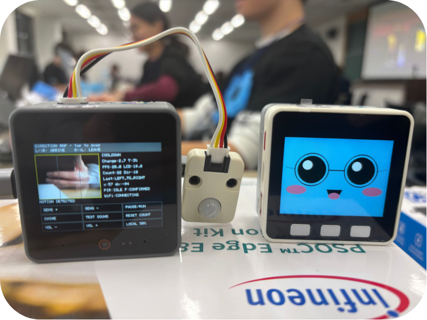
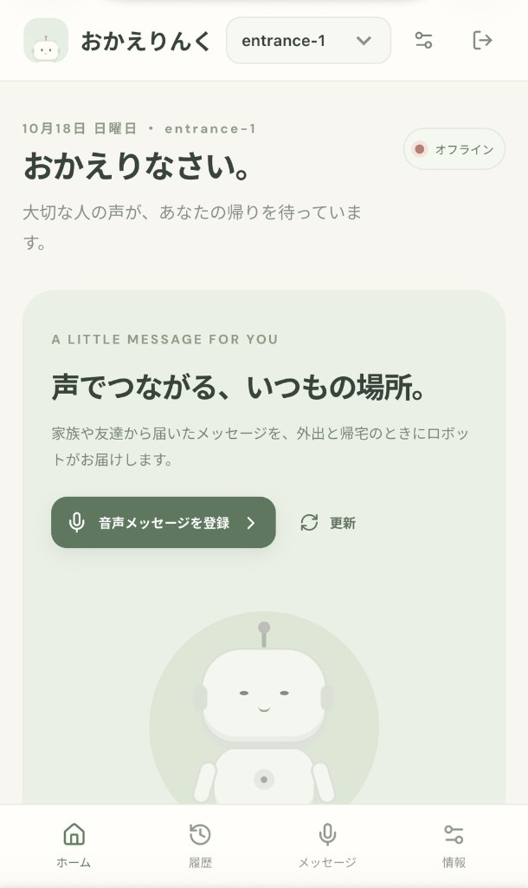
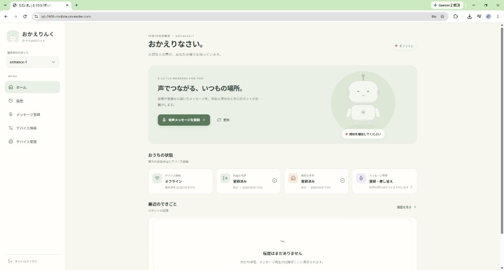

# おかえりんく

<p align="center">
  
</p>

## 各種リンク

- **アプリURL**: https://sd-2605-mobile.onrender.com/
- スライドURL: https://canva.link/qu8e8hxn11fekr0

公開アプリは Render の無料プランです。15分間アクセスがないとサーバーがスリープし、次に開いたときは起動まで数十秒かかります。

<p align="center">
  
</p>

<p align="center">スマートフォンでのアクセスがおすすめです。</p>

大切な人の声で「いってらっしゃい」「おかえり」を届ける、玄関向けの音声メッセージデバイスです。このリポジトリは、その声を登録し、玄関のデバイスへ届けるWebアプリです。

- 本リポジトリ: [jphacks/sd_2605-mobile](https://github.com/jphacks/sd_2605-mobile)
- ハードウェアの開発元: [jphacks/sd_2605](https://github.com/jphacks/sd_2605)

## 製品概要

### 背景(製品開発のきっかけ、課題等）

突然ですが、みなさんは一人暮らしをしたことがありますか？
実際、このプロダクトの開発メンバーは全員が一人暮らしの経験者です。そして、私たちが共通して抱えていた感情、それは――「ふとした瞬間に寂しい」ということでした。

特に、誰もいない玄関を出入りするときの静けさは、一人暮らしならではの孤独感を感じさせます。

そこで私たちは、「離れて暮らす大切な人の温もりを、日々の生活の中で感じられる体験を作りたい」と考えました。

家族や恋人、友人など、遠くに住む人たちが吹き込んでくれた「いってらっしゃい」や「おかえり」の声を、出発や帰宅のタイミングに合わせて届ける。テキストのメッセージとは一味違う、声ならではの温かさで孤独感を和らげるために、このプロダクトを開発しました。

### 製品説明（具体的な製品の説明）

スマートフォンのブラウザから短い音声を録音・登録し、玄関に置いたデバイスが外出時と帰宅時に再生します。アカウント、デバイスの共有、音声の変換と保存、デバイスへの配信をこのWebアプリが担います。

ブラウザのマイクで短い音声を録音・試聴し、外出用と帰宅用を別々に登録します。音声はPCM 16bit・モノラル・16kHzのWAVに変換し、5秒以内・200KiB以下のメッセージとしてサーバーに保存します。玄関のデバイスがこの音声を取得して再生します。

メールアドレスとパスワード、またはGoogleアカウントでログインします。デバイスIDとパスワードで玄関のロボットをアカウントに結びつけます。同じパスワードを知っている家族の別アカウントからも、同じロボットを追加できます。複数台あるときは、操作するロボットを切り替えます。

ホームでは、デバイスの接続状態、外出用・帰宅用の登録状況、最近の外出と帰宅を確認できます。音量は設定画面から0〜100で変更します。登録した声の再生は玄関のデバイス（M5Stack CoreS3）が行います。

<p align="center">
  
</p>

### 特長

#### 1. 大切な人の声を、ブラウザから外出・帰宅のタイミングに

ブラウザで録音・試聴し、外出用（leave）と帰宅用（arrive）の音声を登録できます。録音は5秒で止まり、送る前にWAVへ変換して形式とサイズを確認します。ホームでは、二つの音声が登録済みかを別々に表示します。

<p align="center">
  
  
</p>

#### 2. 家族のアカウントで、同じ玄関デバイスを共有

デバイスにはIDとパスワードがあります。新しく登録することも、登録済みのデバイスをパスワードで追加することもできます。一覧では表示名の変更と、操作中のデバイスの切り替えができます。デバイスを1台も登録していないときは、他のメニューをまだ開けないことが画面で分かります。

#### 3. 版番号で音声を届け、スマホで状態を確認

WAV本体はPostgreSQLに保存し、版番号と同時に更新します。デバイスはheartbeatで版番号を比較し、変わったときだけWAVを取得します。まだ登録していないスロットには、同梱の既定音源を返します。Webではオンライン状態、最終通信、外出と帰宅の履歴を表示します。

<p align="center">
  
  
</p>

### 解決出来ること

- その場にいない家族・友人が、自分の声を玄関の挨拶として届けられます。
- スマホのブラウザから音声を更新でき、玄関のデバイスを操作せずにメッセージを差し替えられます。
- 外出用・帰宅用の音声を分け、生活の場面に合った声かけができます。
- 家族それぞれのアカウントから、同じデバイスの状態と履歴を確認できます。

### 今後の展望

人ごとのメッセージや、日付で切り替わる挨拶へ広げる予定です。どの声がいつ再生されたかを、履歴から確認できるようにすることも対象です。

検知の安定性や設置環境ごとの調整は、ハードウェア側の [jphacks/sd_2605](https://github.com/jphacks/sd_2605) で進めています。

### 注力したこと（こだわり等）

- 玄関デバイスが読めるWAVだけを受け付けること。ブラウザの変換とサーバーの検証で、PCM 16bit・モノラル・16kHz・5秒以内・200KiB以下に揃えています。
- 音声本体と版番号を同時に更新し、形式が合わないファイルのときは以前の音声と版番号を残すこと。
- ログインの失敗と、自分のデバイスではないアクセスを分け、後者ではユーザーのログインを維持すること。
- スマホの画面幅で、録音から状態確認まで一通り操作できること。

## 開発技術

### 活用した技術

#### API・データ

- RailsのJSON API: ユーザー認証、Googleログイン、デバイス登録・共有、設定、音声登録・取得、heartbeat、イベント履歴。
- Web Audio API / MediaRecorder: ブラウザ録音、試聴、16kHzモノラルWAVへの変換。
- PostgreSQL: ユーザー、デバイス、共有メンバー、設定、イベント、音声本体（bytea）の保存。
- デバイス向けAPIは認証なしで、`POST /api/devices/:device_id/heartbeat`、`GET /api/devices/:device_id/audio/:slot`、`POST /api/devices/:device_id/events` を提供します。未知の端末は404になり、自動では登録しません。状態・履歴・設定・音声登録は、ログインと、そのアカウントがそのデバイスを使えることの確認が必要です。

#### フレームワーク・ライブラリ・モジュール

| 対象 | 技術スタック |
| --- | --- |
| Webフロントエンド | TypeScript、React 18、Vite、React Router、Lucide React |
| Webバックエンド | Ruby 3.3、Ruby on Rails 8.1、Puma、JWT、bcrypt、googleauth |
| データ | PostgreSQL 17 |
| 開発・デプロイ | Docker Compose、Render |

#### デバイス

このリポジトリはWebアプリです。玄関側のファームウェアは [jphacks/sd_2605](https://github.com/jphacks/sd_2605) にあります。

| デバイス | このWebアプリからの位置づけ |
| --- | --- |
| スマートフォンのブラウザ | 録音、登録、状態確認、音量変更を行う操作画面 |
| M5Stack CoreS3 | 音声を取得して再生するメインの玄関デバイス。heartbeatとleave/arriveのWAV取得を、Render上の本APIで確認済み |

### 独自技術

#### ハッカソンで開発した独自機能・技術

ブラウザ録音をデバイス再生用WAVへ変換する処理、slot別の音声保存と版管理、端末向けの音声配信、ユーザー認証とデバイス共有を、このハッカソンで実装しました。

- ブラウザでのWAV変換: [`frontend/src/audio.ts`](https://github.com/jphacks/sd_2605-mobile/blob/main/frontend/src/audio.ts)
- 外出用・帰宅用への振り分け: [`frontend/src/pages/VoicePage.tsx`](https://github.com/jphacks/sd_2605-mobile/blob/main/frontend/src/pages/VoicePage.tsx)（commit [`cf14146`](https://github.com/jphacks/sd_2605-mobile/commit/cf14146)）
- デバイスが読めるWAVかの検証: [`backend/app/services/wav_audio.rb`](https://github.com/jphacks/sd_2605-mobile/blob/main/backend/app/services/wav_audio.rb)
- 音声の保存と版番号の同時更新: [`backend/app/services/device_audio_store.rb`](https://github.com/jphacks/sd_2605-mobile/blob/main/backend/app/services/device_audio_store.rb)（commit [`c12af26`](https://github.com/jphacks/sd_2605-mobile/commit/c12af26)）
- デバイス向けAPI: [`backend/app/controllers/api/device_content_controller.rb`](https://github.com/jphacks/sd_2605-mobile/blob/main/backend/app/controllers/api/device_content_controller.rb)
- 家族アカウントでのデバイス共有: [`backend/app/models/device_membership.rb`](https://github.com/jphacks/sd_2605-mobile/blob/main/backend/app/models/device_membership.rb)、[`backend/app/controllers/api/devices_controller.rb`](https://github.com/jphacks/sd_2605-mobile/blob/main/backend/app/controllers/api/devices_controller.rb)（commit [`96ac0bf`](https://github.com/jphacks/sd_2605-mobile/commit/96ac0bf)）
- Googleログイン: [`backend/app/controllers/api/google_sessions_controller.rb`](https://github.com/jphacks/sd_2605-mobile/blob/main/backend/app/controllers/api/google_sessions_controller.rb)（commit [`92a670a`](https://github.com/jphacks/sd_2605-mobile/commit/92a670a)）
- スマホ幅の画面: commit [`3d54581`](https://github.com/jphacks/sd_2605-mobile/commit/3d54581)

## 開発体制・開発経緯

| メンバー | 主な担当 |
| --- | --- |
| 伊藤知世 | Webアプリのフロントエンド開発 |
| 工藤康矢 | Webアプリのバックエンド開発 |
| Norjinkhorloo Tergel | ハードウェアのUI開発 |
| 近藤宙 | ハードウェアの組み立て・組み込み制御ロジックの開発 |

Webアプリはこのリポジトリで開発し、**ハッカソン1日目の夜にハードウェア側 [jphacks/sd_2605](https://github.com/jphacks/sd_2605) へ統合しました**。ハードウェア側ではGit subtreeで履歴を保持し、`apps/` に取り込んでいます。

## リポジトリ構成

| パス | 内容 |
| --- | --- |
| `frontend/` | Webフロントエンド |
| `backend/` | Rails API。既定音源は `backend/config/audio/` |
| `docs/` | テーブル構成の説明 |
| `docs/images/` | READMEの画像 |
| `docker-compose.yml` | ローカルのフロントエンド、API、PostgreSQL |
| `render.yaml`、`Dockerfile.render` | Renderへのデプロイ |

ハードウェア側に取り込んだあとの対応は、`apps/frontend/` と `apps/backend/` です。

## 開発・起動方法

### Webアプリ

Docker Desktopを起動し、このリポジトリの直下で実行します。

```bash
docker compose up --build
```

フロントエンドは `http://localhost:5173`、APIのヘルスチェックは `http://localhost:3000/api/health` です。画面に `status: ok` と出れば、ViteからRailsへ繋がっています。開発用のDBパスワードは `password` です。

ログインはメールアドレスとパスワードです。デバイスID `entrance-1`、仮パスワード `tadaima-demo` の仮ログインは、開発・テスト環境のみで有効です。最初にユーザー登録・ログインし、デバイスID `entrance-1` を登録します。メッセージ登録画面のWAVは、指定がなければ帰宅用（arrive）として保存します。外出用は `slot=leave` です。

画面の詳細は [frontend/README.md](frontend/README.md)、受け入れ条件は [frontend/SPECIFICATION.md](frontend/SPECIFICATION.md) を参照してください。

### Googleログイン

Google Cloud ConsoleでOAuthクライアントID（ウェブアプリケーション）を作り、承認済みのJavaScript生成元に `http://localhost:5173` と公開URLを登録します。クライアントシークレットは使いません。

ローカルではリポジトリ直下の `.env` に次を書いてから `docker compose up` します。このファイルはコミットしません。

```bash
GOOGLE_CLIENT_ID=xxxx.apps.googleusercontent.com
```

未設定のときはGoogleのボタンを出さず、メールアドレスとパスワードのログインだけ使えます。メールアドレスが確認済みで、既存アカウントと同じ場合は、そのアカウントにログインします。

### デプロイ（Render）

フロントエンドのビルド成果物をRailsが配信する1つのWeb Serviceと、PostgreSQLをRenderの無料枠に置きます。設定は `render.yaml` です。

1. このリポジトリをGitHubにpushする
2. [Render](https://render.com) にGitHubでサインアップし、`jphacks` orgのリポジトリへのアクセスを許可する
3. Dashboardの **New > Blueprint** でこのリポジトリを選ぶ。Web ServiceとPostgreSQLが作られる
4. ビルドが終わったら `https://<service>.onrender.com/api/health` が `{"status":"ok"}` になることを確認する

`GOOGLE_CLIENT_ID` は、Googleログインを使うときにBlueprintへ手入力します。pushするたびに自動でデプロイされます。15分アクセスがないとスリープし、次のアクセスで数十秒かかります。無料のPostgreSQLは作成から30日で失効します。

ハードウェア側のモノレポからRenderをビルドする場合は、Root Directoryを `apps`、Dockerfileを `Dockerfile.render` にします。

### ハードウェア側との同期

ハードウェア側リポジトリの作業ツリーがクリーンな状態で、その直下から実行します。

```bash
git subtree pull --prefix=apps https://github.com/jphacks/sd_2605-mobile.git main
```

### テスト

```bash
cd frontend && npm test && npm run build
```

```bash
cd backend
RAILS_ENV=test bundle exec rails db:prepare
bundle exec rails test
```

`device_api_test` は、Webでの登録からheartbeat、WAVの取得、slot別の更新、不正な音声のときの保持、端末イベントの再送、所有者の制限を、RailsとPostgreSQLで検証します。

## 詳細ドキュメント・確認状況

- [frontend/README.md](frontend/README.md)
- [frontend/SPECIFICATION.md](frontend/SPECIFICATION.md)
- [docs/tables.md](docs/tables.md)
- ハードウェア、CoreS3の操作、APIの実機確認: [jphacks/sd_2605](https://github.com/jphacks/sd_2605)

Webの画面とAPIのテストは上記のコマンドで確認しています。玄関デバイスでの発音・センサー検知・画面操作の確認状況は、ハードウェア側のドキュメントに記録しています。

### 旧デモ端末の移行

旧デモ端末の所有者修復は管理用マイグレーション `20261018001000_link_legacy_entrance_device_to_account` で一度だけ実施します。指定された既存アカウントをメールアドレスのダイジェストで照合し、entrance-1が未所有かつパスワード未設定の場合だけ関連づけます。端末の認証情報・保存音声・設定は変更せず、既存の所有者や認証情報がある場合は処理をスキップします。公開APIに所有権確認の例外は追加していません。
